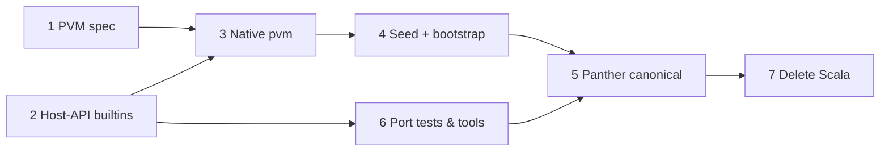

# Removing the Scala dependency

What has to happen for the Panther toolchain to build, test, and run with no
JVM, no sbt, and no Scala source. It is §1 of
[ROADMAP.md](../../ROADMAP.md). Self-hosting is done: `pnc` compiles itself to
a fixed point, and CI requires it. The goal here is
**self-sufficiency**.

Written 2026-10-24 against `5bb9b97`. That day,
`sbt pnc/compile stage3/run` passed with the fixed point
`a0816bc1abaa4ab34d369a227669f3a0b04adc8b348661b4479fd1a7439561e9`
(2,518,316 bytes).

---

## What Scala does today

`pnc` compiling itself does not make it independent. Each `pnc` run still
depends on the JVM in seven places:

| #   | Role                             | Provided by                                                                                                            | Why it blocks removal                                                                                                                                                              |
| --- | -------------------------------- | ---------------------------------------------------------------------------------------------------------------------- | ---------------------------------------------------------------------------------------------------------------------------------------------------------------------------------- |
| 1   | **Source of truth**              | `pncs/`, `runtime/`, `metadata/`, `text/` (Scala). `pnc/src/*.pn` is generated by `sbt pncs/transpile`.                | Nobody edits the Panther sources. Every change starts in Scala.                                                                                                                    |
| 2   | **Host VM**                      | [`VM.scala`](../../pncs/src/main/scala/VM.scala), [`ManagedHeap.scala`](../../pncs/src/main/scala/ManagedHeap.scala)   | `pnc.pnb` is bytecode, and only the Scala VM executes it. `pnc/src/VM.pn` exists, but it is a guest that runs on top of the Scala VM. It does not replace it.                      |
| 3   | **Builtins and primitive types** | `VM.nativeCall`, [`Builtin.scala`](../../metadata/src/main/scala/Builtin.scala). `Value.String` wraps a JVM `String`.  | `string`, `char`, `println`, file I/O, `exit`, and `panic` are all JVM behavior. A `char` is a UTF-16 code unit, `%` follows Java's sign rule, and `string` uses JVM line separators and charsets on output. |
| 4   | **Bootstrap compiler**           | `pncs` compiles `pnc/src` into Stage 2 (`sbt pnc/compile`)                                                             | No checked-in seed image exists, so the only way to get the first `pnc.pnb` is through Scala.                                                                                      |
| 5   | **Build**                        | `build.sbt`, [`project/StdlibBundle.scala`](../../project/StdlibBundle.scala), the `scripts/*.ps1` wrappers around sbt | sbt walks source directories, generates `BundledStdlib.pn`, and runs the stages.                                                                                                   |
| 6   | **Tests**                        | `test/` — 573 ScalaTest cases, about 13.7k lines                                                                       | They call compiler APIs in-process, such as `MakeCompilation.create`, `VM(...)`, and `PnbFile.read`, so they only exercise `pncs`.                                                 |
| 7   | **Tooling**                      | `tools/doccheck`, `tools/stage3`, scalafmt                                                                             | Both tools are Scala programs that link `pncs` as a library.                                                                                                                       |

Rows 2–4 are the critical path. `pnc` can't run without a host VM, and it
can't be built without either a seed image or `pncs`. Rows 1 and 5–7 are
ordinary porting work, but they have to be done in the right order (see
[Ordering](#ordering)).

---

## The target

```text
bootstrap/pnc.pnb  ──pvm──▶  compiles pnc/src  ──▶  stage1.pnb
stage1.pnb         ──pvm──▶  compiles pnc/src  ──▶  stage2.pnb
stage2.pnb         ──pvm──▶  compiles pnc/src  ──▶  stage3.pnb   (== stage2.pnb)
```

- **`pvm`** is a native executable that loads and runs a `.pnb` image. It
  replaces row 2 and row 3.
- **`bootstrap/pnc.pnb`** is a checked-in seed compiler image. It replaces
  row 4.
- **`pnc/src`** (and `stdlib/src`) are hand-edited Panther and are the only
  compiler source.
- Build, test, and doccheck are Panther programs run by `pvm`, or thin
  scripts around it. Building `pvm` itself needs only a C (or Rust) toolchain.

The fixed point keeps its meaning but changes inputs. Today it shows that
`pncs` and `pnc` agree. Afterwards it shows that the compiler built by the
seed and the compiler built by itself agree.

---

## Phases

### Phase 1 — Specify the PVM

**Status: specification written** — [pvm.md](pvm.md). It covers the image
format and every table, the five value kinds, the frame and call model, the
heap and collector contract, all 56 opcodes, and all 24 builtins, including
the JVM behaviour that leaks through (UTF-16 strings, wrapping arithmetic,
5-bit shift counts, signed `readAllBytes`).

What remains is its §9: twelve reference behaviours that look accidental
(D1–D12). Examples are a failed `cast` that keeps running, `1 / 0` and stack
overflow crashing the JVM instead of trapping, `int("-")` being 0, and
`bool(string)` disagreeing between `pncs` and `pnc`.

**Exit:** each of D1–D12 is either fixed in Scala, so both VMs agree, or
adopted into the spec as a requirement.

### Phase 2 — Fill the host-API gaps while Scala is still the oracle

The builtin set covers what the compiler needs when sbt hands it a file list.
It doesn't cover what a build driver, a test runner, or doccheck needs. Add
these to `Builtin`, the Scala VM, and `VM.pn` now, while both hosts can be
checked against each other:

| Builtin                                                 | Needed by                                                                 |
| ------------------------------------------------------- | ------------------------------------------------------------------------- |
| `Directory.files(path)` / `Directory.directories(path)` | Build driver (replaces sbt's `** "*.pn"`), Stage 3, doccheck, test runner |
| `eprintln` / `eprint`                                   | Diagnostics and test output on stderr                                     |
| `Environment.get(name)`                                 | `UPDATE_SNAPSHOTS=1`-style switches                                       |
| `File.delete`, `Directory.create`                       | Build outputs under `target/`                                             |

Hashing is not a builtin. Stage 3 only needs byte equality, and SHA-256 can be
written in Panther if a printed hash is wanted.

Process spawning is deliberately left out. The tools below link the compiler
as a library, so they never need to spawn `pnc` as a subprocess.

**Exit:** each new builtin has a `BuiltinTests` case, and the Stage 3 fixed
point still holds.

### Phase 3 — Native `pvm`

This builds on ROADMAP §3.1, which asks for a `pvm` command over
`ImageRunner`. Here it becomes a native program.

1. **JVM `pvm` first (small).** Wire `pvm image.pnb args…` over
   `ImageRunner` and `runWithArgs`. It defines the CLI contract (heap and stack
   flags, exit codes) and gives the native VM a reference to diff against.
2. **Native `pvm`** in `pvm/`, implemented from the Phase 1 spec. It needs:
   - The image loader and a switch-dispatch interpreter for the 56 opcodes.
   - The 24 builtins, using UTF-16 strings (or UTF-8 storage with UTF-16
     indexing; that choice is internal as long as the spec holds).
   - A precise mark-and-sweep collector over a slot heap.
   - A **panic stack trace** with method names and, where metadata allows,
     source locations. Today a compiler crash produces a JVM stack trace
     through `VM.scala`. Once Scala is gone, `pvm` is the only debugger.
3. **Differential conformance.** Add a `PVM` environment variable to the
   Scala test suite that runs every image-producing test (`VmTests`,
   `SampleTests`, `PnbTests`, `BuiltinTests`, `GarbageCollectorTests`) through
   the native `pvm` as well as the in-process VM. Outputs and exit codes must
   match. This is how Scala serves as the oracle before it is deleted.
4. **Self-hosting on the native host:**

   ```bash
   pvm pnc/target/pnc.pnb --no-stdlib out.pnb $(find pnc/src -name '*.pn' | sort)
   cmp out.pnb pnc/target/pnc.pnb
   ```

   Add this check to CI alongside the existing `stage3/run`.

**Exit:** the native `pvm` reproduces the Stage 3 hash and the stdlib checks
(matching user images, standalone execution, `--run`, replacement bundle) on
Linux, macOS, and Windows. It runs Stage 3 within the current 15-minute CI
budget, and its peak RSS should come in well under the JVM's ~1.9 GiB.

### Phase 4 — Seed image and bootstrap

1. Commit `bootstrap/pnc.pnb`, about 2.5 MB, plus `bootstrap/README.md` that
   records the hash, the commit that produced it, and the `pvm` version it
   needs.
2. Write `scripts/bootstrap.ps1` (later a Panther driver; see Phase 6) that
   runs the three-step chain from [The target](#the-target) and fails unless
   `stage2 == stage3`.
3. **Re-seed policy.** The compiler source can only use language features the
   seed understands, so a new feature lands in two steps:
   1. Implement the feature without using it in the compiler, then re-seed.
   2. Start using it in the compiler.

   The seed changes only in a dedicated commit that runs the bootstrap and
   records the new hash. CI checks that the seed is a fixed point of the
   current sources, or one step behind them.

4. **Image format versioning.** A change to `.pnb` or the opcode set must keep
   the seed loadable. Either `pvm` reads both versions for one release, or the
   change is re-seeded in the same commit.

**Exit:** a fresh clone with only a C toolchain can build `pvm`, bootstrap
`pnc`, and reach the fixed point. No JVM is installed.

### Phase 5 — Make the Panther sources canonical

This is the flip. Before it, every change starts in Scala. After it, every
change starts in `pnc/src`.

1. **Clean the generated sources once**, in the last transpiled commit:
   - Remove Scala-isms from comments (references to `toString`, Scala
     overloads, case classes, `pncs`) and fix doc comments that describe
     "the Scala version".
   - Organise `pnc/src` into directories (`syntax/`, `binding/`, `lowering/`,
     `emit/`, `vm/`, `metadata/`, `text/`) now that it no longer has to
     mirror the Scala layout.
2. **Deduplicate the standard library.** `pnc/src` currently has its own
   `List.pn`, `Option.pn`, `Result.pn`, `Either.pn`, `Dictionary.pn`, and
   `Tuple2.pn`, transpiled from `runtime/`, which duplicate `stdlib/src`.
   `stdlib/src` becomes canonical. The compiler build compiles it alongside
   `pnc/src` instead of using `--no-stdlib` with private copies.
3. **Replace `StdlibBundle.scala`.** `BundledStdlib.pn` embeds `stdlib/src` as
   string literals. Generate it with a small Panther program
   (`tools/bundle.pn`) run by `pvm`, and have CI check that it is up to date.
   This becomes the same kind of check the `transpile` job does today.
4. **Remove the Scala→Panther transpiler from `pnc`.** `Transpiler.pn` and
   the `--transpile` flag only make sense while Scala is the source. They
   stay in `pncs` until Phase 7 deletes it.
5. **Freeze `pncs`.** Mark it read-only in `CONTRIBUTING.md`. Remove the
   `transpile` CI job. From here on, `pncs` and `pnc` are allowed to diverge.

**Prerequisite:** Phase 6's test and doccheck ports must be in place, or land
in the same change. Otherwise the 573 tests and doccheck keep checking a
frozen `pncs` while all real changes go to `pnc`, and nothing checks the
compiler that matters.

### Phase 6 — Port tests and tools to run on `pnc`

#### Tests

Today's suites are stage-shaped (ROADMAP, cross-cutting). Porting is a good
time to make them **fixture-shaped**: a directory of source files with
expected outputs, run by one driver.

```text
tests/
  lexer/      *.pn  → *.tokens
  parser/     *.pn  → *.ast
  binder/     *.pn  → *.symbols / *.diagnostics
  types/      *.pn  → *.symbols / *.diagnostics
  lowering/   *.pn  → *.lowered
  emit/       *.pn  → *.disasm
  vm/         *.pn  → *.out + *.exit
  samples/    (today's SampleTests snapshots, moved as-is)
```

- The driver is `tools/testrunner.pn`. It is compiled together with
  `pnc/src` so it calls the compiler in-process, the way ScalaTest does. It
  walks `tests/` (using the Phase 2 `Directory` builtins), runs each stage's
  printer, diffs the result against the expected file, and supports an
  update mode for snapshots.
- `pnc` gains whatever printing flags are missing, such as `--print-tokens`,
  `--print-ast`, and a stable `--print-diagnostics` format, so every stage
  has a text form to snapshot.
- **Triage the 573 tests.** For each suite, decide whether it moves to
  fixtures, becomes a Panther-level `assert` test, or is dropped:
  - `TranspilerTests` and `TranspileSnapshotTests` are dropped along with the
    transpiler.
  - `DictionaryTests`, `MetadataTests`, and `ArgsParserTests` become Panther
    programs that call the library and `assert`.
  - `GarbageCollectorTests` splits. The heap internals become `pvm`-native
    tests, and the observable behavior becomes `vm/` fixtures.
  - `LexerTests`, `ParserTests`, `BinderTests`, `TypeTests`, `VmTests`, and
    `SampleTests` become fixtures.
- Record the triage in a table in this doc as it happens, with each suite's
  count before and after.
- **Multiple entry points.** The compiler, the test runner, and doccheck all
  share `pnc/src`. `pnc` needs either an `--entry Object.main` flag or a
  convention for excluding `Program.pn` when linking a tool.

#### doccheck

Port `tools/doccheck` (four Scala files) to Panther and link it against
`pnc/src`, so it binds with the real front end in-process, the same way it
does today. Its CLI, annotations, and `baseline.txt` stay unchanged. This is
also a good point to add the ROADMAP §4.1 item "execute blocks and check
output", since `pvm` makes running a block cheap.

#### Stage 3

`tools/stage3` becomes `scripts/bootstrap.ps1` from Phase 4, or a Panther
driver. The heap statistics it prints today move into a `pvm --stats` flag.

**Exit:** CI runs the fixture suite, doccheck, and bootstrap without sbt. The
counts match or beat today's: 0 failing doc blocks, fixed point verified, and
every ported test passing.

### Phase 7 — Delete Scala

Delete the following once Phases 1–6 are complete and green for at least one
release:

- `pncs/`, `runtime/`, `metadata/`, `text/`, `test/`, `tools/stage3/`, and
  the Scala sources under `tools/doccheck/`.
- `build.sbt`, `project/`, `.scalafmt.conf`, the scalafmt, scalafix, and
  scoverage plugins, and the `test`, `transpile`, and `lint` CI jobs.

Then update everything that describes the old world:

- `README.md` and `CONTRIBUTING.md` (setup becomes a C toolchain plus
  `scripts/bootstrap.ps1`).
- [`.github/instructions/copilot.instructions.md`](../../.github/instructions/copilot.instructions.md),
  which is already stale: it still says self-hosting is unfinished.
- The `code` roots in [`primitives.yaml`](primitives.yaml), which list a
  `.scala` file and its `.pn` twin for each primitive.
- The visual-recap skill.
- ROADMAP's tracking table (commands become `pvm`/script invocations).

Formatting enforcement disappears with scalafmt. `.editorconfig` remains. A
Panther formatter is a separate project and doesn't block this one.

---

## Ordering



- Phases 1 and 2 can run in parallel. Phase 6 can start as soon as Phase 2
  lands, because the fixture runner works on the JVM `pvm` too.
- **Phase 5 is the point of no return.** Everything before it is additive:
  Scala stays the source and the oracle, and every step is checked against it.
  Don't flip until `pnc` is built by the native `pvm` from the seed and is
  tested by suites that run against `pnc` itself.

---

## Not blockers, but they hurt more after the flip

Today these language gaps are absorbed by writing Scala. After the flip,
anyone maintaining the compiler writes Panther by hand every day. None of
them block the phases above, since the existing code already works without
them, but they become higher priority (ROADMAP, cross-cutting):

- No `return`, `break`/`continue`, or compound assignment (`+=`).
- No lambdas. The test runner and doccheck would benefit most from them.
- Arrays cannot resize (four `TODO`s in `Parser`).
- No hex literals. Opcode and magic constants are written in decimal.
- Variance and upper bounds are not enforced (ROADMAP §2.1, §2.2). The Scala
  type checker currently covers for this. After Phase 7, only Panther's
  checker remains.

Each of these follows the two-step re-seed policy from Phase 4.

---

## Open decisions

| Decision                      | Options                                                                                | Leaning                                                                                                                                                                                    |
| ----------------------------- | -------------------------------------------------------------------------------------- | ------------------------------------------------------------------------------------------------------------------------------------------------------------------------------------------ |
| `pvm` implementation language | C11, Rust, Zig                                                                         | **C11**. It has the smallest bootstrap dependency (any `cc`), which matches the aim of shrinking what you need to trust and install. Rust is safer but adds `cargo` and a large toolchain. |
| Where the seed lives          | In-tree binary, Git LFS, GitHub release asset                                          | **In-tree.** About 2.5 MB, changes rarely, and a clone is self-contained.                                                                                                                  |
| Panther-side string encoding  | UTF-16 (match JVM), UTF-8 with code-unit indexing, switch `char` to code points        | **Match the JVM** until after Phase 7. Changing semantics during the port would break the differential tests that make the port safe.                                                      |
| Keep `VM.pn` inside `pnc`?    | Keep (`pnc --run` stays self-contained), or drop it and have `--run` hand off to `pvm` | **Keep** for now. It is covered by Stage 3's `--run` check and costs nothing extra.                                                                                                        |
| Build driver                  | `pwsh` scripts, Make, a Panther program                                                | **`pwsh`** first, since the repo already standardises on it. Move to Panther once Phase 2's builtins exist.                                                                                |

---

## Tracking

| Metric                                                | Now                                         | Target          | Command                                         |
| ----------------------------------------------------- | ------------------------------------------- | --------------- | ----------------------------------------------- |
| PVM spec coverage (opcodes / builtins)                | 56/56, 24/24                                | 56/56, 24/24    | [`pvm.md`](pvm.md)                              |
| PVM spec defects settled (§9)                         | 0/12                                        | 12/12           | [`pvm.md` §9](pvm.md#9-defects-to-settle)       |
| Native `pvm` conformance (tests passing under `PVM=`) | —                                           | all image tests | `PVM=pvm/pvm sbt test/test`                     |
| Native-host fixed point                               | —                                           | verified in CI  | Phase 3 step 4                                  |
| Bootstrap from seed without a JVM                     | no                                          | yes             | `scripts/bootstrap.ps1`                         |
| Tests ported to fixtures                              | 0 / 573                                     | triaged 573     | `pvm target/testrunner.pnb tests/`              |
| doccheck on `pnc`                                     | no                                          | 0 failing       | `pvm target/doccheck.pnb docs/language` |
| Scala source lines                                    | ~25k (`pncs`) + runtime/metadata/text/tests | 0               | `git ls-files '*.scala' \| xargs wc -l`         |
